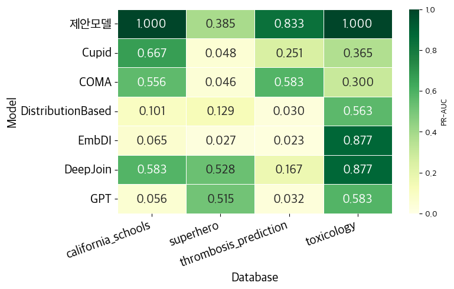
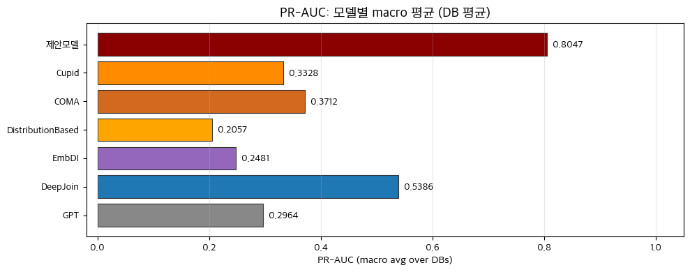
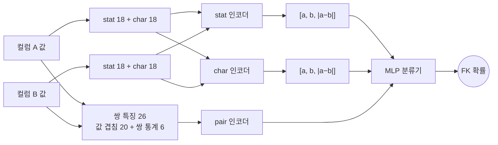

# CRIM — 데이터 프로파일링 기반 컬럼 관계(PK-FK) 추론

**데이터 프로파일링 기반 통계/패턴 특징을 활용한 컬럼 관계 추론 기법**
(Column Relationship Inference Using Data Profiling-based Statistical and Pattern Features)

숭실대학교 정보과학대학원 인공지능학과 석사학위논문 (2026) · 정보과학대학원 우수논문상

스키마 문서, 업무 규칙, 컬럼명 같은 배경지식 없이 **데이터 값 자체의 특징만으로** 테이블 간 PK-FK 관계를 추론합니다.
문서화되지 않은 레거시 DW, 컬럼명이 일관되지 않거나 익명화된 데이터에서도 조인 관계를 찾는 것이 목표입니다.

## 결과 요약

BIRD 벤치마크의 4개 DB 에서, 학습에 쓰지 않은 데이터로 평가한 PR-AUC 입니다.
CRIM 은 TPC-H / TPC-DS 로만 학습했습니다.

| 모델 | california_schools | superhero | thrombosis_prediction | toxicology | **평균 PR-AUC** | 평균 Recall@K | 평균 Recall@3K |
|---|---|---|---|---|---|---|---|
| **CRIM (제안)** | **1.000** | 0.385 | **0.833** | **1.000** | **0.8047** | **0.7159** | **0.9318** |
| DeepJoin | 0.583 | **0.528** | 0.167 | 0.877 | 0.5386 | 0.4614 | 0.8523 |
| COMA | 0.556 | 0.046 | 0.583 | 0.300 | 0.3712 | 0.3500 | 0.5704 |
| Cupid | 0.667 | 0.048 | 0.251 | 0.366 | 0.3328 | 0.3000 | 0.5750 |
| GPT-4o | 0.056 | 0.515 | 0.032 | 0.583 | 0.2964 | 0.3886 | 0.6250 |
| EmbDI | 0.065 | 0.027 | 0.023 | 0.877 | 0.2481 | 0.2000 | 0.2500 |
| DistributionBased | 0.101 | 0.129 | 0.031 | 0.563 | 0.2058 | 0.2182 | 0.3636 |

<p>


</p>

- **Recall@K**: 점수 상위 K(=정답 FK 수)개 안에 정답이 들어온 비율. **Recall@3K** 는 상위 3K 개 기준입니다.
- 컬럼명·테이블명을 해시로 바꾼 마스킹 DB(`<db>_mask`)에서도 같은 정답 공간으로 평가해, 모델이 이름에 의존하지 않는지 검증합니다.

## 방법



**특징 (컬럼 쌍당 98차원)**
- `stat` (컬럼별 18): 고유값·중복 비율, 빈도 분포(top-k 비율, 평균/중앙 빈도), 수치 통계 등
- `char` (컬럼별 18): 숫자·영문·구분자 비율, ID·코드·이름·날짜·이메일·URL 패턴 비율 등 값의 형태
- `ov` (쌍 26): Jaccard, 양방향 containment 와 그 차이, 고유값 비율 비교 같은 FK 방향성 신호 등 값 겹침 20 + 쌍 통계 6

**모델**: 두 컬럼에 같은 인코더를 적용하는 Siamese 구조로 `stat`·`char` 를 각각 `[a, b, |a−b|]` 로 결합하고,
쌍 특징은 별도 인코더를 거쳐 MLP 분류기로 FK 확률을 냅니다.

**학습**
- TPC-H / TPC-DS 의 FK 만 정답으로 사용 (평가 DB 는 학습에서 완전히 제외)
- 양성: 테이블을 85% 표본추출해 같은 FK 를 여러 분포로 증강
- 음성: 무작위 쌍 + 값이 겹치지만 FK 가 아닌 hard negative + 합성 trap 5종
  (중간 cardinality, 이름형, 코드형, 좁은 범위 숫자, 중간 크기 숫자 ID) — 양성:음성 = 1:2
- BCE 손실, SWA(Stochastic Weight Averaging), 고정 seed 와 결정론적 연산으로 같은 환경에서 같은 가중치를 재현

### Branch ablation

같은 데이터·seed 로 branch 조합 7가지를 학습한 결과입니다. 전체 조합이 논문의 제안모델입니다.

| branch | california_schools | superhero | thrombosis_prediction | toxicology | 평균 PR-AUC | 평균 R@K | 평균 R@3K |
|---|---|---|---|---|---|---|---|
| `stat` | 0.325 | 0.113 | 0.833 | 0.648 | 0.4798 | 0.2477 | 0.8182 |
| `char` | 0.182 | 0.140 | 0.122 | 0.399 | 0.2109 | 0.1454 | 0.2136 |
| `ov` | 0.583 | 0.502 | 0.503 | 1.000 | 0.6470 | 0.6136 | 0.8523 |
| `stat+char` | 0.583 | 0.122 | 0.750 | 0.648 | 0.5259 | 0.4182 | 0.8182 |
| `stat+ov` | 1.000 | 0.400 | 0.750 | 1.000 | 0.7874 | 0.6932 | **0.9773** |
| `char+ov` | 0.583 | **0.580** | 0.611 | 1.000 | 0.6936 | 0.6364 | 0.8523 |
| **`stat+char+ov`** | **1.000** | 0.385 | **0.833** | **1.000** | **0.8047** | **0.7159** | 0.9318 |

값 겹침(`ov`)이 가장 강한 단일 신호이고, 통계(`stat`)와 결합할 때 성능이 크게 오릅니다.
문자 형태(`char`)는 단독으로는 약하지만 전체 조합에서 평균 PR-AUC 와 Recall@K 를 끌어올립니다.

## 비교 모델

| 모델 | 노트북 | 구현 |
|---|---|---|
| Cupid · COMA · DistributionBased | `20_baseline_valentine.ipynb` | Valentine 프레임워크 (Koutras et al., ICDE 2021) |
| DeepJoin | `21_baseline_deepjoin.ipynb` | Dong et al., VLDB 2023 의 임베딩 기반 joinable column 탐색을 `all-MiniLM-L6-v2` 로 재구현 |
| EmbDI | `22_baseline_embdi.ipynb` | Cappuzzo et al., SIGMOD 2020 의 그래프 구성(행·값·컬럼 노드) + Word2Vec 을 단순화해 구현 |
| GPT-4o | `23_baseline_gpt4o.ipynb` | 컬럼쌍별 이름·프로파일 통계·샘플 값을 주고 FK 확률을 받음 (temperature 0) |

모든 모델은 같은 후보쌍(서로 다른 테이블의 컬럼쌍, 방향 없음)과 같은 지표로 평가합니다.

## 재현 방법

### 1. 환경

```bash
pip install -r requirements.txt
```

COMA(Valentine)는 Java 8 이상이 필요합니다.

### 2. 평가 데이터: BIRD

[BIRD](https://bird-bench.github.io/) dev 셋을 내려받아 다음 위치에 둡니다.

```
data/bird/dev_databases/<db>/<db>.sqlite
data/bird/dev_tables.json
```

### 3. 학습 데이터: TPC-H / TPC-DS

공식 생성기로 데이터를 만들고 `scripts/prepare_tpc.py` 로 CRIM 학습 형식으로 변환합니다.
생성기는 [TPC 공식 사이트](https://www.tpc.org/)에서 등록 후 받을 수 있고, 아래는 공개 미러 저장소를 쓰는 예입니다.

**TPC-H — dbgen**

```bash
git clone https://github.com/electrum/tpch-dbgen.git
cd tpch-dbgen
make CC=gcc DATABASE=ORACLE MACHINE=LINUX WORKLOAD=TPCH
./dbgen -s 1          # Scale Factor 1 (약 1GB). 테이블 8개가 *.tbl 로 생성
```

**TPC-DS — dsdgen** (TPC-DS 의 생성기는 이름이 `dsdgen` 입니다)

```bash
git clone https://github.com/gregrahn/tpcds-kit.git
cd tpcds-kit/tools
make OS=LINUX         # gcc, bison, flex 필요
mkdir -p /path/to/tpcds-data
./dsdgen -SCALE 1 -DIR /path/to/tpcds-data    # 테이블 24개가 *.dat 로 생성
```

macOS 등 다른 환경의 빌드 옵션은 각 저장소의 README 를 참고하세요.

**변환**

생성 결과는 헤더가 없고 `|` 로 구분된 파일이라, 공식 DDL 에서 컬럼명을 읽어 CSV 로 바꾸고
RI(참조 무결성) 정의에서 FK 목록을 뽑아 학습 정답 파일을 만듭니다.

```bash
python scripts/prepare_tpc.py \
  --tpch-dir    path/to/tpch-dbgen \
  --tpcds-dir   /path/to/tpcds-data \
  --tpcds-tools path/to/tpcds-kit/tools \
  --out data/tpc
```

```
data/tpc/sf1/tpch_<table>.csv     TPC-H (TPC-DS 의 customer 와 이름이 겹치지 않도록 접두어)
data/tpc/tpcds/<table>.csv        TPC-DS
data/tpc/train/*.csv              특징 추출용 컬럼 풀 (위 두 폴더의 합집합)
data/tpc/ground_truth_tpc.json    학습용 FK 정답 (TPC-H 9개, TPC-DS 102개)
```

### 4. 노트북 실행

`notebooks/` 에서 번호 순서대로 실행합니다. 모든 산출물은 `workspace/` 에 저장됩니다.

| 순서 | 노트북 | 내용 |
|---|---|---|
| 01 | `01_extract_bird.ipynb` | BIRD SQLite → 테이블별 CSV + DB 별 `ground_truth.json` |
| 02 | `02_mask_bird.ipynb` | 컬럼·테이블명을 해시로 바꾼 `<db>_mask` 생성 |
| 10 | `10_crim_train_ablation_eval.ipynb` | CRIM 학습(branch 7종) · 추론 · 지표 저장 |
| 20 | `20_baseline_valentine.ipynb` | Cupid · COMA · DistributionBased |
| 21–23 | `21_baseline_deepjoin.ipynb` 외 | DeepJoin · EmbDI · GPT-4o (GPT-4o 는 OpenAI API 키 필요) |
| 30 | `30_compare_results.ipynb` | 전체 결과 통합 표 · 그래프 · 마스킹 일관성 검증 |

CRIM 학습 데이터 구성은 단계마다 체크포인트를 남기므로, 중단돼도 이어서 실행됩니다
(`FORCE_RECOMPUTE = True` 로 처음부터 다시 생성).

## 구조

```
notebooks/            실험 노트북 (출력 제거)
scripts/prepare_tpc.py  TPC 생성 결과 → 학습 CSV + FK 정답
docs/figures/         결과 그림
tests/                변환 스크립트 테스트, 노트북 위생 검사(출력·로컬 경로·API 키)
data/, workspace/     입력 데이터와 산출물 (git 제외)
```

## 한계

- 평가 DB 가 4개이고 DB 당 정답 FK 가 2~11개로 적어, DB 하나의 결과가 평균에 크게 영향을 줍니다.
- 값이 겹치는 정도를 핵심 신호로 쓰기 때문에, 부모 테이블의 일부만 참조하거나 코드 값처럼 범위가 좁은 컬럼(superhero)에서는 오탐이 남습니다.
- 단일 컬럼 FK 만 다루며 복합 키 관계는 대상이 아닙니다.

## 참고문헌

- Koutras et al., *Valentine: Evaluating Matching Techniques for Dataset Discovery*, ICDE 2021
- Madhavan et al., *Generic Schema Matching with Cupid*, VLDB 2001
- Do & Rahm, *COMA — A System for Flexible Combination of Schema Matching Approaches*, VLDB 2002
- Zhang et al., *Automatic Discovery of Attributes in Relational Databases*, SIGMOD 2011 (DistributionBased)
- Dong et al., *DeepJoin: Joinable Table Discovery with Pre-trained Language Models*, VLDB 2023
- Cappuzzo et al., *Creating Embeddings of Heterogeneous Relational Datasets for Data Integration Tasks*, SIGMOD 2020 — [원본 코드](https://gitlab.eurecom.fr/cappuzzo/embdi) (Apache-2.0)
- Li et al., *Can LLM Already Serve as A Database Interface? A BIg Bench for Large-Scale Database Grounded Text-to-SQLs (BIRD)*, NeurIPS 2023
- TPC-H / TPC-DS, Transaction Processing Performance Council

## License

이 저장소의 코드는 MIT 라이선스입니다. 비교 모델과 데이터셋은 각 원저작물의 라이선스를 따릅니다.
